<p align="center">
  <a href="https://github.com/beapama"></a>
  
</p>

<p align="center">
  <a href="https://www.linkedin.com/in/beatrizpama"></a>
  <a href="https://YOUR_PORTFOLIO_LINK"></a>
  <a href="https://www.credly.com/users/beatriz-pama"></a>
</p>

<p align="center">
  
  
  
</p>

## 🧬 about

```python
me = {
    "does":     "backend & data for financial systems",
    "based":    "São Paulo, Brazil",
    "was":      "intern @ QI Tech, BTG Pactual & IBM",
    "degree":   "Computer Engineering, Escola Politécnica da USP",
    "learning": "GenAI engineering: RAG, agents, LLM evals",
    "speaks":   ["Portuguese", "English", "French"],
    "pronouns": "she/her",
}
```

<details>
<summary><b>🌱 how I got here. click for the short version</b></summary>
<br />
<table>
  <tr><td><b>2020</b></td><td>Joined Poli Júnior and coordinated the commercial, HR and finance teams.</td></tr>
  <tr><td><b>2022</b></td><td>First summer at BTG Pactual, building apps for the trading desk.</td></tr>
  <tr><td><b>2023</b></td><td>IBM: helped build a client's GCP cloud from scratch, talking to business, legal and tech every day.</td></tr>
  <tr><td><b>2025</b></td><td>QI Tech: backend for treasury, owning an API end to end for the first time.</td></tr>
  <tr><td><b>2026</b></td><td>Diving into GenAI, building finance projects with LLMs.</td></tr>
</table>
</details>

## 💼 experience

<table>
  <tr>
    <td width="36%" valign="top"><b>Backend Engineering Intern</b><br /><sub>QI Tech · 2025 to 2026</sub></td>
    <td valign="top">Owned the backend of an API that invests fund accounts' idle cash on D+0 and returns it with yield on D+1, <b>replacing a daily manual process run by 5+ teams</b>. Mapped the process with the business team, pushed to split it into microservices, modeled the MySQL database from scratch and deployed on GCP with Terraform. Also built a pre-matching API for government bond trades.<br /><br /><code>Python</code> <code>FastAPI</code> <code>MySQL</code> <code>GCP</code> <code>Pub/Sub</code> <code>Terraform</code></td>
  </tr>
  <tr>
    <td width="36%" valign="top"><b>Software Engineering Intern</b><br /><sub>BTG Pactual · 2022, 2024, 2025</sub></td>
    <td valign="top">First two summers: <b>moved the trading desk off a slow, error-prone legacy platform</b> to a faster, cleaner web app with more features. Third summer, in offshore funds: wrote Jest unit tests that <b>raised coverage above 95%</b>, and maintained the client-facing UI/UX.<br /><br /><code>TypeScript</code> <code>React</code> <code>Jest</code></td>
  </tr>
  <tr>
    <td width="36%" valign="top"><b>Business & Data Analysis Intern</b><br /><sub>IBM Brazil · 2023 to 2024</sub></td>
    <td valign="top">Started in quality assurance, improving the experience of the client's end users. Then, on a cloud project, <b>brought the client's sales data from many partners into one place</b>: it used to arrive by email, spreadsheets and other sales-tracking platforms, and now lands in a single cloud setup with dashboards on top.<br /><br /><code>GCP</code> <code>Salesforce</code> <code>QA</code></td>
  </tr>
</table>

## 🚀 projects

<table>
  <tr>
    <td width="50%" valign="top">
      <h3>📈 <a href="https://PROJECT_LINK">The Self-Explaining Chart</a></h3>
      <sub><b>GenAI · B3 stocks · in progress</b></sub>
      <p>A stock chart for B3 tickers where an LLM explains what happened on the days with big moves.</p>
      <p><code>Python</code> <code>LLMs</code> <code>Market data</code></p>
      <a href="https://PROJECT_LINK"></a>
    </td>
    <td width="50%" valign="top">
      <h3>🏦 Copom Tone Tracker</h3>
      <sub><b>NLP · monetary policy · in progress</b></sub>
      <p>Uses an LLM to score the tone of Brazil's Central Bank (Copom) minutes and compares it with the interest rate decisions that followed.</p>
      <p><code>Python</code> <code>LLMs</code></p>
    </td>
  </tr>
  <tr>
    <td width="50%" valign="top">
      <h3>📰 Daily Market Brief</h3>
      <sub><b>AI automation · in progress</b></sub>
      <p>An automated daily market summary written by AI, with a page that keeps the history.</p>
      <p><code>Python</code> <code>LLMs</code></p>
    </td>
    <td width="50%" valign="top">
      <h3>📂 <a href="https://github.com/beapama?tab=repositories">More Work</a></h3>
      <sub><b>everything else</b></sub>
      <p>More projects live here.</p>
    </td>
  </tr>
</table>

## 🧰 stack

<p align="center">
  
</p>

<p align="center"><b>Working on something in fintech, data or AI? I'd love to hear about it.</b></p>

<p align="center">
  <a href="https://www.linkedin.com/in/beatrizpama"></a>
</p>

<p align="center"></p>
